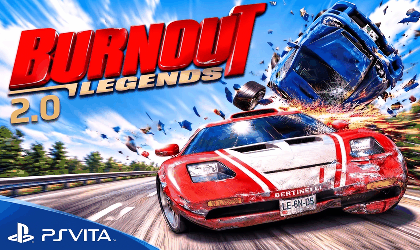
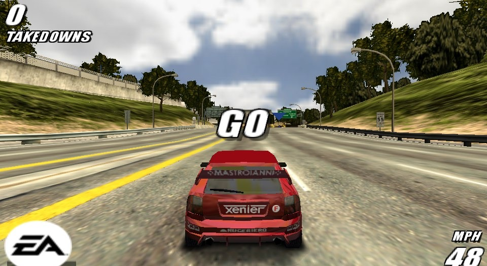
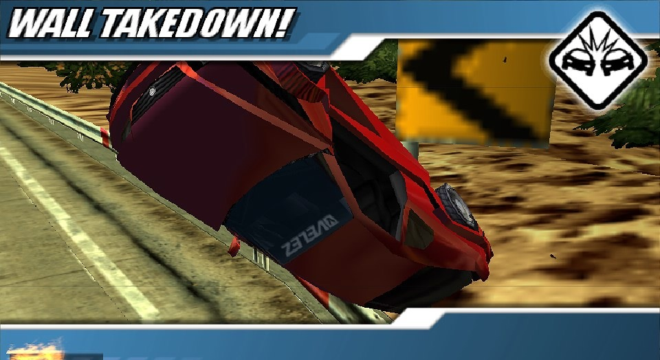
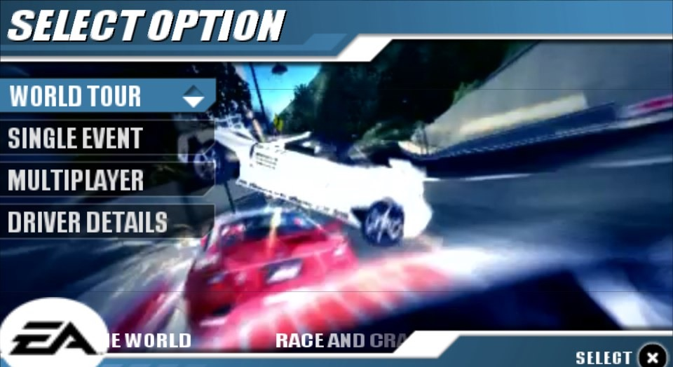

# Burnout Legends sur PS Vita (recompilation native)

Un portage natif de **Burnout Legends** (PSP) sur PS Vita, obtenu en recompilant
statiquement l'exécutable PSP du jeu en code ARM avec [PSPRecomp](docs/PSPRecomp.md).
Ce n'est pas un émulateur : le code du jeu tourne nativement, avec un rendu
(vitaGL), un son, des vidéos et des sauvegardes refaits pour la Vita.

*English version: [README.md](README.md)*

> **Il faut votre propre exemplaire du jeu.** Ce dépôt ne contient aucun fichier
> du jeu, aucun exécutable du disque et aucun code du jeu recompilé. Faites une
> copie de votre propre UMD.

## Captures

Prises sur PS Vita :

| | |
|---|---|
|  |  |

## Fonctionnalités

- Courses à 30 fps en 960x544 (la résolution dynamique tient la cadence sur les
  circuits les plus lourds ; les menus et la voiture du joueur restent en pleine
  résolution)
- Son, musiques et vidéos des menus
- Fenêtre de sauvegarde native de la Vita
- **Vos sauvegardes PSP / Adrenaline sont reprises directement** : celles déjà
  présentes sur votre carte mémoire (`ux0:pspemu`, `uma0:pspemu`, `imc0:pspemu`,
  `ur0:pspemu`, `xmc0:pspemu`) apparaissent avec la mention « - PSP ». Rien à
  copier ni à convertir, et une sauvegarde écrite par le portage se recharge dans
  Adrenaline. Une copie de vos sauvegardes Adrenaline est faite au premier
  lancement dans `ux0:data/burnout/backup_adrenaline/`.

## Nouveautés de la 0.0.2 : Burnout Legends 2.0

### Le menu BONUS 2.0

Une nouvelle entrée dans le menu principal, avec de nouvelles récompenses à gagner
dans le jeu. Chaque nouvelle récompense est annoncée à la fin de la course, comme
les déblocages du jeu.

| Récompense | Comment l'obtenir |
|---|---|
| **Voitures Collector** | Chaque Takedown Signature vous donne sa voiture Collector. L'écran de fin de course montre la photo du takedown et la voiture. |
| **Nouvelles couleurs** | Les trophées Takedown ajoutent cinq couleurs (orange, rose, vert lime, argent, or) pour toutes vos voitures. Au choix de la voiture, **CARRÉ** passe des couleurs d'origine aux couleurs 2.0. |
| **Filtres visuels** | Chacune des 10 Épreuves spéciales vous donne un filtre : Noir et blanc, Sépia, Saturé, Journal, VHS, Brut, Art et essai, Vintage, Négatif et Cel Shading. Activez-les dans BONUS 2.0, même en pleine course. |
| **Poids lourds en Course simple** | Chaque Gros titre de crash débloque un poids lourd (bus, camions...) à conduire en Course simple ; le camion de pompiers demande les dix. |
| **EA GAMES TRAX** | Un raccourci vers la liste des musiques, avec vos propres morceaux (voir plus bas). |

### Autres nouveautés

- Un nouvel écran titre avec le logo 2.0.
- Des courses plus fluides : rendu plus rapide, moins d'à-coups au chargement des
  pistes, plus de mémoire libre en course (corrige un gel lors des gros crashs).
- Le soleil n'affiche plus de rectangle lumineux ni de carré noir dans le ciel.
- Facultatif : avec le plugin CapUnlocker, le son tourne sur le quatrième cœur de
  la Vita.

### Musiques perso

1. Copiez vos fichiers **MP3** dans `ux0:data/burnout/musique_perso/`.
2. Lancez le jeu : ils apparaissent dans **EA GAMES TRAX** à côté des morceaux du
   jeu, avec leur titre, leur artiste et leur album. Vous pouvez activer ou couper
   chacun d'eux comme les morceaux du jeu. Ils passent en course et dans les menus.

- Le titre et l'artiste viennent des tags du MP3. S'il n'y en a pas, nommez le
  fichier `Artiste - Titre.mp3`.
- 23 morceaux au maximum.
- **MP3 uniquement.** Les autres formats sont ignorés, par exemple un AAC ou un M4A
  renommé en `.mp3`. Convertissez-les d'abord en MP3.

## Version du jeu prise en charge

| | |
|---|---|
| Jeu | Burnout Legends, Europe |
| Disque | **ULES00125**, DISC_VERSION 1.01 |
| SHA-256 de l'`EBOOT.BIN` déchiffré | `89263a8f1f262971ad85761202fa6b02f4dfc86b3fbc733402ec20d0003e57c4` |

Les autres versions (US ULUS10025, autres révisions) ne sont pas encore prises en
charge : le code recompilé correspond à cet exécutable précis.

## Prérequis

- Une PS Vita / PS TV sous HENkaku / Ensō, avec [VitaShell](https://github.com/TheOfficialFloW/VitaShell)
- `libshacccg.suprx` (le compilateur de shaders de la Vita) dans
  `ur0:data/external/`. Si vous ne l'avez pas, extrayez-le avec
  [ShaRKBR33D](https://github.com/Rinnegatamante/ShaRKBR33D) puis copiez-le en
  `ur0:data/external/libshacccg.suprx`.
- Votre propre image de Burnout Legends (**ULES00125**), ISO ou CSO, celle
  que vous utilisez avec Adrenaline
- Environ 700 Mo libres sur `ux0:`
- Facultatif : le plugin CapUnlocker (le son tourne alors sur le quatrième cœur de
  la Vita). Le jeu marche aussi sans.

## Installation

1. Mettez votre ISO ou CSO de Burnout Legends dans **`ux0:pspemu/ISO/`** (là où
   Adrenaline la cherche ; `uma0:`, `imc0:` et `xmc0:` marchent aussi). Le nom du
   fichier n'a pas d'importance.
2. Installez le VPK avec VitaShell.
3. Lancez **Burnout Legends 2.0**. Le premier lancement installe le jeu tout seul
   depuis votre ISO (copie des fichiers, déchiffrement du jeu, conversion des
   musiques) : environ 10 minutes, une seule fois. Si elle est interrompue, elle
   reprend là où elle s'était arrêtée. Ensuite le jeu démarre.

Si aucune ISO n'est trouvée, le jeu vous le dit : copiez-la dans
`ux0:pspemu/ISO/` et relancez. Une fois installé, le portage n'a plus besoin de
l'ISO (il a sa propre copie dans `ux0:data/burnout/`) ; gardez-la si vous jouez
aussi au jeu dans Adrenaline.

**Mise à jour depuis la 0.0.1 :** installez le nouveau VPK par-dessus l'ancien.
Le jeu installé et vos sauvegardes sont gardés.

Chaque lancement reste ensuite environ une minute sur le logo, le temps de
compiler les shaders pour votre console.

## Commandes

Celles de la PSP, sur les mêmes boutons.

## Problèmes connus

- De courts ralentissements peuvent arriver sur les plus grands circuits
  (Waterfront, Downtown) quand une nouvelle partie du circuit se charge.
- Environ une minute de chargement à chaque lancement (compilation des shaders).
- Seule la version ULES00125 v1.01 est prise en charge.

## Signaler un bug

Joignez le log : **`ux0:data/burnout-0.0.2.log`** (et `.log.prev`, la partie
précédente). Dites sur quel circuit et ce que vous faisiez. Le log note déjà la
mémoire utilisée et chaque image trop lente.

## Compiler soi-même

Voir [profiles/burnout/README.md](profiles/burnout/README.md) (en anglais). En
bref : déchiffrer l'exécutable, lancer le recompilateur dessus (le code généré
reste sur votre PC), puis compiler la cible Vita avec VitaSDK.

## Crédits et licences

- [PSPRecomp](https://github.com/jessicanataliagta/PSPRecomp) de Jessica Natalia
  et contributeurs (MIT) : le recompilateur et le runtime sur lesquels repose ce
  portage.
- [vitaGL](https://github.com/Rinnegatamante/vitaGL) de Rinnegatamante (OpenGL sur
  le GXM de la Vita), avec un petit patch (`profiles/burnout/tools/vitagl-*.patch`).
- Le chiffrement des sauvegardes PSP (`profiles/burnout/host/psp_savedata.cpp`)
  est porté de [PPSSPP](https://github.com/hrydgard/ppsspp) et est sous
  **GPL-2.0-or-later** ; une version Vita qui l'inclut est donc distribuée sous GPL.
- Installation au premier lancement : le déchiffreur PRX et libkirk de PPSSPP
  (GPL-2.0) déchiffrent l'exécutable du jeu, et le décodeur ATRAC3plus de FFmpeg
  (LGPL-2.1, `at3_standalone` de PPSSPP) convertit les musiques.
- [minimp3](https://github.com/lieff/minimp3) (CC0) lit les musiques perso.
- La police [Oswald](https://fonts.google.com/specimen/Oswald) (SIL Open Font
  License) dans le menu BONUS 2.0.
- [stb_image](https://github.com/nothings/stb) (domaine public).
- Le reste du dépôt est sous licence MIT ([LICENSE](LICENSE)).

Burnout et Burnout Legends sont des marques d'Electronic Arts. Ce projet n'est
ni affilié à Electronic Arts ou Criterion Games, ni approuvé par eux.
