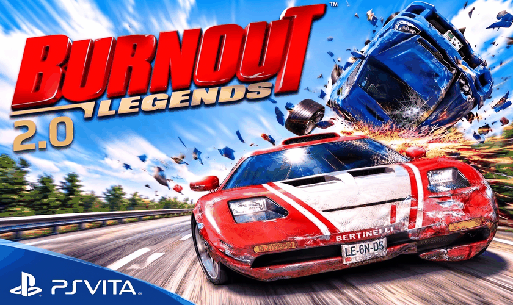
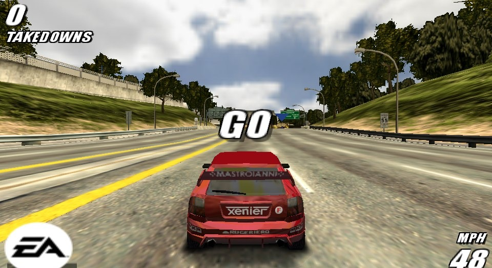
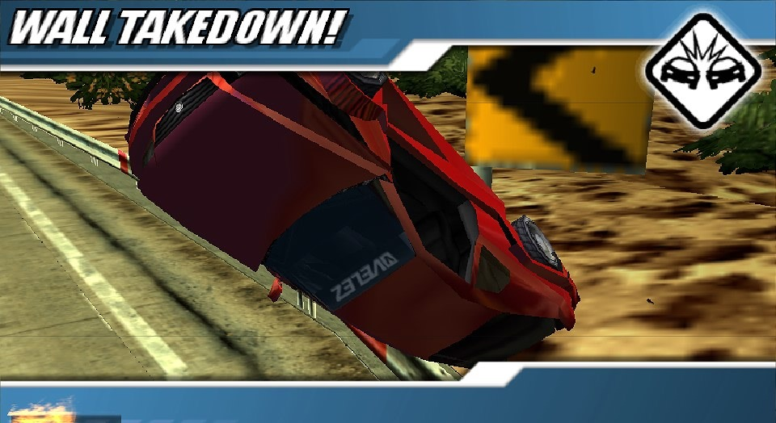
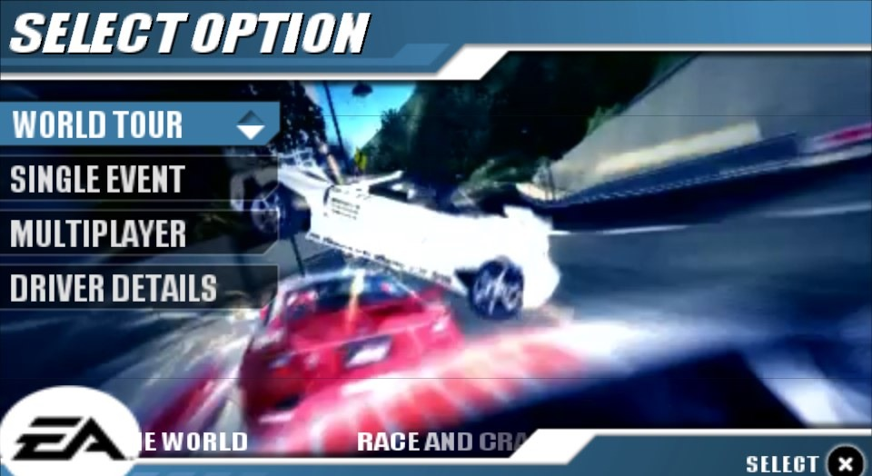

# Burnout Legends for PS Vita (native recompilation)

A native PS Vita port of **Burnout Legends** (PSP), made by statically recompiling
the game's PSP executable to ARM with [PSPRecomp](docs/PSPRecomp.md). It is not an
emulator: the game's code runs natively, with its own renderer (vitaGL), sound,
movies and saves rebuilt for the Vita.

*Version française : [README.fr.md](README.fr.md)*

> **You need your own copy of the game.** This repository contains no
> game file, no executable from the disc and no recompiled game code. Dump your own UMD.

## Trailer

https://github.com/user-attachments/assets/69993d45-fb54-40fa-ac10-d913aeec1261

*The video is compressed for GitHub: the game looks much sharper on the Vita's screen.*

## Screenshots

Taken on a PS Vita:

| | |
|---|---|
|  |  |

## Features

- Races in HD (960x544) at 30 fps. Dynamic resolution keeps the frame rate on the
  heaviest tracks; the menus and your car stay at full resolution.
- Sound, music and the menu movies.
- Native Vita save dialog.
- **Your PSP / Adrenaline saves work directly.** The port lists the saves already
  on your memory card (`ux0:pspemu`, `uma0:pspemu`, `imc0:pspemu`, `ur0:pspemu`,
  `xmc0:pspemu`), labelled "- PSP". There is nothing to copy or convert, and a save
  written by the port still loads in Adrenaline. At first launch, a backup of your
  Adrenaline saves is made in `ux0:data/burnout/backup_adrenaline/`.

## New in 0.0.2: Burnout Legends 2.0

### The BONUS 2.0 menu

A new entry in the main menu, with new rewards to earn in the game. Each new reward
is announced at the end of the race, like the game's own unlocks.

| Reward | How to earn it |
|---|---|
| **Collector cars** | Each Signature Takedown gives you its Collector car. The end-of-race screen shows the takedown photo and the car. |
| **New car colours** | The Takedown trophies add five new colours (orange, pink, lime green, silver, gold) for all your cars. In car select, **SQUARE** switches between the original colours and the 2.0 ones. |
| **Visual filters** | Each of the 10 Special Events gives you a filter: Black & White, Sepia, Saturated, Newspaper, VHS, Gritty, Arthouse, Vintage, Negative and Cel Shading. Switch them on in BONUS 2.0, even during a race. |
| **Heavyweights in Single Event** | Each Crash Headline unlocks a Heavyweight (buses, trucks...) to drive in Single Event races; the Fire Truck needs all ten. |
| **EA GAMES TRAX** | A shortcut to the music list, with your own songs (see below). |

### Also new

- A new title screen with the 2.0 logo.
- Smoother races: faster rendering, fewer hitches when a track loads, and more
  free memory during races (this fixes a freeze on big crashes).
- The sun no longer shows a light rectangle or a black square in the sky.
- Optional: with the CapUnlocker plugin installed, the sound runs on the Vita's
  fourth core.

### Custom soundtracks

1. Copy your **MP3** files to `ux0:data/burnout/musique_perso/`.
2. Start the game: they appear in **EA GAMES TRAX** next to the game's songs, with
   their title, artist and album. You can turn each one on or off, like the game's
   songs, and they play in races and in the menus.

- The title and artist come from the MP3 tags. If there are none, name the file
  `Artist - Title.mp3`.
- Up to 23 songs.
- **MP3 only.** Other formats (AAC or M4A files renamed to `.mp3`, for example)
  are skipped. Convert them to MP3 first.

## Supported game versions

| Region | Disc | Decrypted `EBOOT.BIN` SHA-256 |
|---|---|---|
| Europe | **ULES00125**, DISC_VERSION 1.01 | `89263a8f1f262971ad85761202fa6b02f4dfc86b3fbc733402ec20d0003e57c4` |
| USA (since 0.0.3) | **ULUS10025**, DISC_VERSION 1.00 | `166bf5a428ff5b9f46192bf80ec3f26cfff1d1833af50ea74fa81d23906e70f2` |

Both have the same game code, byte for byte, and the same 6 languages: the game
uses your Vita's language. The install recognises your version by itself. Other
versions (Japan ULJM05049, Korea ULKS46027, other revisions) are not supported yet.

## Requirements

- A PS Vita / PS TV on HENkaku / Ensō, with [VitaShell](https://github.com/TheOfficialFloW/VitaShell)
- `libshacccg.suprx` (the Vita's shader compiler) in `ur0:data/external/`.
  If you do not have it, extract it with
  [ShaRKBR33D](https://github.com/Rinnegatamante/ShaRKBR33D) and copy it to
  `ur0:data/external/libshacccg.suprx`.
- Your own Burnout Legends disc image (**ULES00125** or **ULUS10025**), ISO or CSO: the one you
  play with Adrenaline
- About 700 MB free on `ux0:`
- Optional: the CapUnlocker plugin (the sound then runs on the Vita's fourth
  core). The game works the same without it.

## Installation

1. Put your Burnout Legends ISO or CSO in **`ux0:pspemu/ISO/`**, where Adrenaline
   looks for it (`uma0:`, `imc0:` and `xmc0:` work too). Any file name works.
2. Install the VPK with VitaShell.
3. Start **Burnout Legends 2.0**. The first launch installs the game from your
   ISO (it copies the game files, decrypts the game and converts the music).
   This takes about 10 minutes and happens only once. If it is interrupted, it
   resumes where it stopped. Then the game starts.

If no ISO is found, the game tells you so: copy it to `ux0:pspemu/ISO/` and start
again. Once installed, the port no longer needs the ISO, because it keeps its own
copy in `ux0:data/burnout/`. Keep the ISO if you also play the game in Adrenaline.

**Updating from 0.0.1:** install the new VPK over the old one. Your installed game
and your saves are kept.

Each launch spends about a minute on the logo screen while the shaders are
compiled for your console.

## Controls

The PSP controls, on the same buttons.

## Known issues

- Short slowdowns can happen on the largest tracks (Waterfront, Downtown) when a
  new part of the track streams in.
- About a minute of loading at each start (shader compilation).
- Only ULES00125 v1.01 and ULUS10025 v1.00 are supported (the install checks it).
- To switch to the other version, delete `ux0:data/burnout/` (keep `musique_perso/` and `unlocks.bin` if
  you use them) and start the game again with the other ISO.

## Reporting a bug

Please attach the log: **`ux0:data/burnout-0.0.3.log`** (and `.log.prev`, the
previous run). Say which track and what you were doing. The log already
records memory use and every slow frame.

## Building from source

See [profiles/burnout/README.md](profiles/burnout/README.md). In short: decrypt
the executable, run the recompiler on it (the generated code stays on your PC),
then build the Vita target with VitaSDK.

## Credits and licences

- [PSPRecomp](https://github.com/jessicanataliagta/PSPRecomp) by Jessica Natalia
  and contributors (MIT): the recompiler and runtime this port is built on.
- [vitaGL](https://github.com/Rinnegatamante/vitaGL) by Rinnegatamante (OpenGL on
  the Vita's GXM), used with a small patch (`profiles/burnout/tools/vitagl-*.patch`).
- PSP savedata encryption (`profiles/burnout/host/psp_savedata.cpp`) is ported
  from [PPSSPP](https://github.com/hrydgard/ppsspp) and is **GPL-2.0-or-later**;
  a Vita build that includes it is therefore distributed under the GPL.
- First-launch install: PPSSPP's PRX decrypter and libkirk (GPL-2.0) decrypt
  the game's executable, and the FFmpeg ATRAC3plus decoder (LGPL-2.1, PPSSPP's
  `at3_standalone`) converts the music.
- [minimp3](https://github.com/lieff/minimp3) (CC0) plays the custom soundtracks.
- [Oswald](https://fonts.google.com/specimen/Oswald) font (SIL Open Font License)
  in the BONUS 2.0 menu.
- [stb_image](https://github.com/nothings/stb) (public domain).
- The rest of this repository is under the MIT licence ([LICENSE](LICENSE)).

Burnout and Burnout Legends are trademarks of Electronic Arts. This project is
not affiliated with or endorsed by Electronic Arts or Criterion Games.
